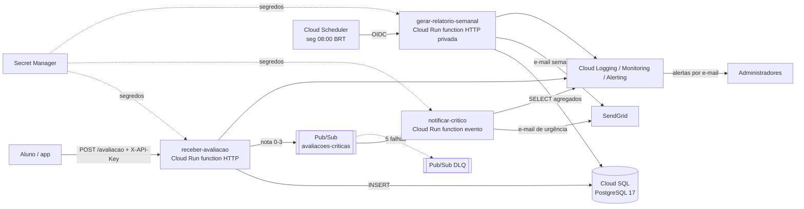

# Plataforma de Feedback de Cursos — Java serverless na GCP

Sistema serverless para receber feedbacks de alunos, avisar os administradores sobre avaliações **críticas** e enviar um
**relatório semanal** com a média das notas. Roda 100% na **Google Cloud Platform** (nenhum componente de outra nuvem).

## 1. Arquitetura



### Modelo de nuvem e justificativas
- **FaaS (Cloud Run functions, 2ª geração, Java 21)**: paga-se só pela execução, escala a zero e o free tier mensal cobre a demonstração.
- **Responsabilidade única** — três funções independentes:

| Função | Gatilho | Única responsabilidade | Acessa |
|---|---|---|---|
| `receber-avaliacao` | HTTP `POST /avaliacao` | Validar, persistir e publicar evento se crítica | Postgres, Pub/Sub (publicar) |
| `notificar-critico` | Pub/Sub | Enviar o e-mail de urgência | SendGrid (sem banco) |
| `gerar-relatorio-semanal` | Cloud Scheduler | Agregar dados e enviar relatório | Postgres (leitura), SendGrid |

- **Pub/Sub** desacopla o recebimento da notificação: um problema no e-mail nunca derruba o recebimento de feedbacks e há retentativa + dead-letter.
- **PostgreSQL (Cloud SQL)**: dados relacionais e relatórios por agregação (`AVG`, `GROUP BY`). **Não há NoSQL**: o modelo é uma tabela simples. (Se algum dia for preciso, na GCP o MongoDB não é nativo; a alternativa sem custo é o **Firestore**.)
- **E-mail**: a GCP não oferece serviço de e-mail transacional próprio; usa-se o **SendGrid** (plano gratuito).

### Regra de urgência
| Nota | Urgência | Efeito |
|---|---|---|
| 0–3 | CRÍTICA | e-mail imediato aos administradores |
| 4–6 | MÉDIA | apenas registro |
| 7–10 | BAIXA | apenas registro |

## 2. Estrutura do repositório
```
common/                    modelo, repositório JDBC, e-mail, logs, migrações Flyway
receber-avaliacao/         função HTTP
notificar-critico/         função Pub/Sub
gerar-relatorio-semanal/   função agendada
scripts/                   provisionamento, deploy, monitoramento, teste e2e, limpeza
monitoring/                políticas de alerta (JSON)
cloudbuild.yaml            CI/CD (deploy automatizado)
openapi.yaml               contrato da API
docs/                      monitoramento e roteiro do vídeo
```

## 3. Deploy (passo a passo)

**Pré-requisitos:** conta GCP gratuita com os créditos iniciais, `gcloud`, Java 21, Maven 3.9+, `cloud-sql-proxy` v2, uma conta SendGrid (free) com remetente verificado.

```bash
gcloud auth login && gcloud projects create SEU-PROJETO && gcloud billing projects link SEU-PROJETO --billing-account=ID
export PROJECT_ID=SEU-PROJETO ADMIN_EMAILS="admin@exemplo.com" EMAIL_FROM="noreply@exemplo.com"
# opcional (recomendado): export BILLING_ACCOUNT=XXXXXX-XXXXXX-XXXXXX

./scripts/01-setup-gcp.sh          # APIs, IAM, Pub/Sub, segredos, orçamento
printf '%s' 'SG.sua-chave' | gcloud secrets versions add sendgrid-api-key --data-file=-
./scripts/02-database.sh           # Cloud SQL Postgres + migrações Flyway
./scripts/04-deploy.sh             # build, testes, 3 funções, Scheduler, dead-letter
./scripts/05-monitoring.sh         # métricas, alertas por e-mail
./scripts/06-teste-e2e.sh          # demonstração / teste de ponta a ponta
```

### Deploy automatizado (CI/CD)
Crie um gatilho do **Cloud Build** apontando para o repositório (branch `main`) usando `cloudbuild.yaml`. Conceda à conta de serviço do Cloud Build:
`roles/cloudfunctions.developer`, `roles/run.admin`, `roles/iam.serviceAccountUser`, `roles/pubsub.admin`, `roles/cloudscheduler.admin`, `roles/secretmanager.viewer`. A cada push, o pipeline roda os testes e republica as funções (idempotente).

### Custos e créditos
- Use **somente** os créditos iniciais (US$ 300 / 90 dias) da conta gratuita; não ative créditos adicionais.
- O item que consome crédito é o **Cloud SQL** (o Cloud SQL não tem camada gratuita): instância mínima `db-f1-micro`, HDD 10 GB, zonal, sem backup. Funções, Pub/Sub, Scheduler (3 jobs), Secret Manager e Logging ficam dentro do free tier.
- Após gravar o vídeo: `./scripts/99-cleanup.sh pausar` (ou `apagar`).
- A versão do Postgres está em `scripts/00-config.sh` (`DB_VERSION`); confirme a mais recente disponível no Cloud SQL.

## 4. Segurança e governança de acesso
- **IAM de menor privilégio**: uma *service account* por função; só `receber-avaliacao` publica no tópico; só `gerar-relatorio-semanal` é invocada pelo Scheduler (OIDC); `notificar-critico` não tem acesso ao banco.
- **Sem chaves JSON**: as funções usam a identidade anexada ao serviço.
- **Segredos** (senha do banco, chave do SendGrid, chave da API) no **Secret Manager**, injetados como variáveis de ambiente; nada no repositório.
- **Banco**: SSL obrigatório, sem redes autorizadas; acesso apenas pelo *Cloud SQL Java Connector* (TLS + IAM `cloudsql.client`). Em produção real, recomenda-se IP privado (exige conector VPC, que tem custo e por isso não é usado aqui).
- **Endpoint público** protegido por cabeçalho `X-API-Key` e `max-instances=2` (limita abuso e custo). Para produção: API Gateway/Cloud Armor.
- **Dados dos clientes**: validação de entrada, consultas parametrizadas, escape de HTML nos e-mails, logs sem conteúdo das avaliações.

## 5. Monitoramento
Logs JSON, métricas baseadas em log, dashboard e alertas por e-mail: ver [docs/monitoramento.md](docs/monitoramento.md).

## 6. Documentação das funções

### `receber-avaliacao` — `br.com.feedback.receber.ReceberAvaliacaoFunction`
`POST /avaliacao` · cabeçalho `X-API-Key` · corpo `{"descricao": "texto", "nota": 0..10}`

| Status | Quando |
|---|---|
| 201 | `{"id","urgencia","dataEnvio"}` |
| 400 | JSON inválido, descrição vazia/>2000 caracteres, nota fora de 0–10 |
| 401 / 405 / 500 | chave inválida / método diferente de POST / erro interno |

Variáveis: `PROJECT_ID`, `PUBSUB_TOPIC`, `INSTANCE_CONNECTION_NAME`, `DB_NAME`, `DB_USER`, `DB_PASSWORD`*, `API_KEY`* (*segredos).

```bash
curl -X POST "$URL/avaliacao" -H "Content-Type: application/json" -H "X-API-Key: $KEY" \
     -d '{"descricao":"Áudio inaudível no módulo 3","nota":1}'
```

### `notificar-critico` — `br.com.feedback.notificar.NotificarCriticoFunction`
Consome a mensagem do Pub/Sub e envia ao(s) administrador(es) o e-mail de urgência com **Descrição, Urgência e Data de envio**.
Falhas são relançadas → retentativa do Pub/Sub → dead-letter após 5 tentativas (gera alerta).
Variáveis: `ADMIN_EMAILS`, `EMAIL_FROM`, `SENDGRID_API_KEY`*.

### `gerar-relatorio-semanal` — `br.com.feedback.relatorio.GerarRelatorioSemanalFunction`
Executada toda segunda às 08:00 (America/Sao_Paulo) pelo Cloud Scheduler. Envia e-mail com: **média das notas**, **quantidade por dia**, **quantidade por urgência** e a lista com **descrição, urgência e data de envio** dos últimos 7 dias.
Variáveis: `INSTANCE_CONNECTION_NAME`, `DB_NAME`, `DB_USER`, `DB_PASSWORD`*, `ADMIN_EMAILS`, `EMAIL_FROM`, `SENDGRID_API_KEY`*.

## 7. Desenvolvimento e testes
```bash
mvn clean verify -DskipITs   # testes unitários + uber jars (target/<modulo>.jar)
mvn clean verify             # inclui teste de integração com PostgreSQL 17 via Testcontainers (requer Docker)
```
Modelo de dados: `common/src/main/resources/db/migration/V1__cria_tabela_avaliacao.sql` (Flyway).

## 8. Vídeo de demonstração
Roteiro em [docs/roteiro-video.md](docs/roteiro-video.md).
